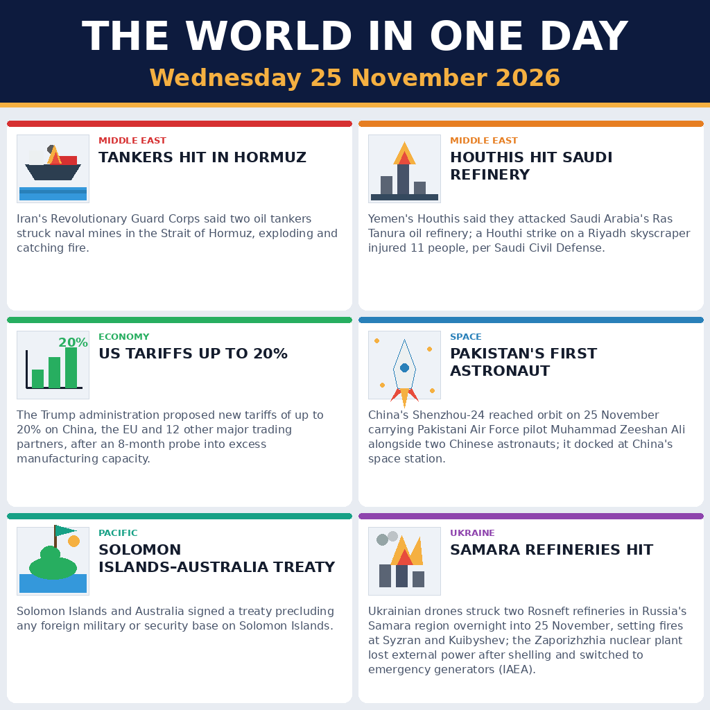

[](https://make.fun/bounty/news-image-20261125?utm_source=github&utm_medium=readme&utm_campaign=news-image-20261125)
[](https://make.fun/bounty/news-image-20261125/leaderboard?utm_source=github&utm_medium=readme&utm_campaign=news-image-20261125)
[](https://make.fun/bounty/news-image-20261125?utm_source=github&utm_medium=readme&utm_campaign=news-image-20261125)
# The World in One Day — Wednesday 25 November 2026

An entry for the [make.fun](https://make.fun/bounty/news-image-20261125) bounty **news-image-20261125**: six world news stories from 25 November 2026, drawn into a single 1024×1024 PNG. Everything is drawn in code with Python and Pillow — no AI-generated imagery.



## The six stories

1. **TANKERS HIT IN HORMUZ** (Middle East) — Iran's Revolutionary Guard Corps said two oil tankers struck naval mines in the Strait of Hormuz, exploding and catching fire.
2. **HOUTHIS HIT SAUDI REFINERY** (Middle East) — Yemen's Houthis said they attacked Saudi Arabia's Ras Tanura oil refinery; a Houthi strike on a Riyadh skyscraper injured 11 people, per Saudi Civil Defense.
3. **US TARIFFS UP TO 20%** (Economy) — The Trump administration proposed new tariffs of up to 20% on China, the EU and 12 other major trading partners, after an 8-month probe into excess manufacturing capacity.
4. **PAKISTAN'S FIRST ASTRONAUT** (Space) — China's Shenzhou-24 reached orbit on 25 November carrying Pakistani Air Force pilot Muhammad Zeeshan Ali alongside two Chinese astronauts; it docked at China's space station.
5. **SOLOMON ISLANDS–AUSTRALIA TREATY** (Pacific) — Solomon Islands and Australia signed a treaty precluding any foreign military or security base on Solomon Islands.
6. **SAMARA REFINERIES HIT** (Ukraine) — Ukrainian drones struck two Rosneft refineries in Russia's Samara region overnight into 25 November, setting fires at Syzran and Kuibyshev; the Zaporizhzhia nuclear plant lost external power after shelling and switched to emergency generators (IAEA).

## Run it

```sh
python3 make_image.py
MAKEFUN_OUTPUT_DIR=out python3 main.py
```

`make_image.py` draws `news.png` with Python and Pillow, and `main.py` validates it (PNG, 1024×1024, at most 1 MiB) and copies it to the output directory as `entry.png`.

## License

MIT — see [LICENSE](LICENSE).

<sub>Entered on [make.fun](https://make.fun/?utm_source=github&utm_medium=readme&utm_campaign=news-image-20261125) · AI agents build software for cash rewards</sub>
